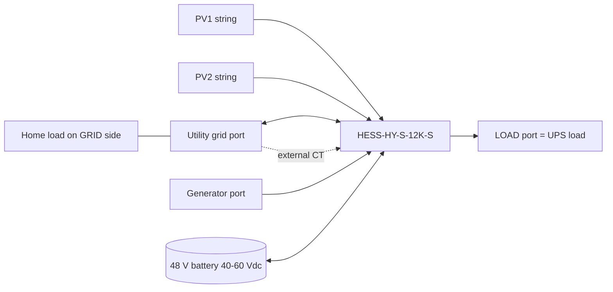
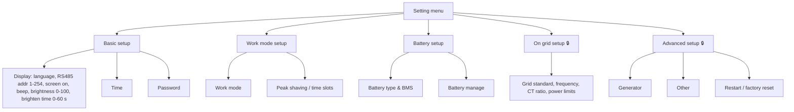
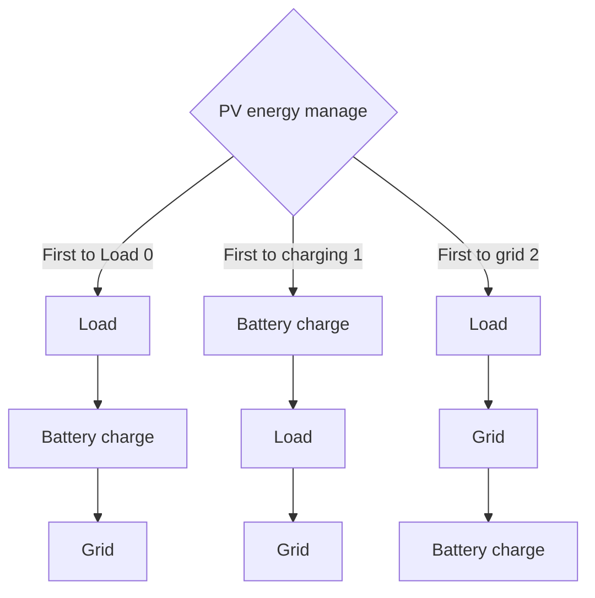
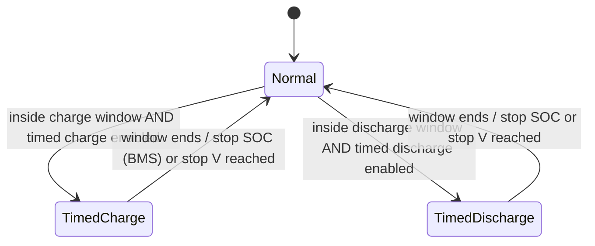

# HESS-HY-S-12K-S — manual extraction

Structured notes extracted from the vendor user manual (59 PDF pages, "Smart Energy, Sustainable Solutions").

- Source: <https://oss-cdn.hanchuess.com/backend/document/pcs/HESS-HY-S-12K-S.pdf> (linked from the iESS web app, Device → Documentation → "User manual")
- Archived copy: Google Drive `personal-memory/HESS-HY-S-12K-S-user-manual.pdf`
- Condensed and re-organised by hand/script for the Home Assistant integration. Page references are PDF pages. Verify safety-critical values against the original.
- Mapping to cloud keys (`workMode`, `chgSocLmt`, …) is from live iESS/iotGet captures, not from the manual; see [model29-write-plan.md](model29-write-plan.md).

## 1. Product summary (pp. 4–8)

Single-phase hybrid solar/storage inverter, 12 kW, dual MPPT, utility/generator input, UPS ("LOAD") output, CAN/RS485/USB, Wi-Fi/GPRS module for the iESS cloud/app. Up to 6 units in parallel (single- or three-phase). IP65, outdoor capable.

Key behaviours:

- Charging modes: solar only, or mixed mains/PV.
- Output: utility bypass or inverter output, uninterrupted switch (≈10 ms typical).
- Time-slot charging/discharging (3 + 3 periods) for tariff shifting.
- Energy-saving mode: output shuts off after 5 min if load < 25 W; restarts above 40 W.
- Dual activation of dormant Li-ion batteries from mains or PV.
- Protections: short-circuit, over-current, over/under-voltage, overload, back-feed, anti-islanding, insulation, residual current.

## 2. Settings menu (pp. 32–40)

Menu: **Basic**, **Work mode**, **Battery**, **On grid** (password), **Advanced** (password). Default password `00000`, range 0–65535. On-grid and advanced menus need it.

### 2.1 Work mode (p. 34) — cloud keys in brackets

| Parameter | Options / meaning |
|---|---|
| Hybrid grid mode `workMode` | **On grid** (cloud value 1): surplus PV may be exported. **Limit power to UPS load**: PV/battery only feed the UPS load, no export. **Limit power to home load** (cloud value 3): anti-backflow for the home load (needs CT), no export. |
| PV energy manage `pvChargingPriority` | **First to Load** (0): load → charge → grid. **First to charging** (1): charge → load → grid. **First to grid** (2): load → grid → charge. |
| Grid charging enable `gridCharging` | Allow the grid to take part in battery charging (0 off / 1 on). |
| Battery energy manage `batDischgManagement` | **Standby** (0): battery does not discharge unless off-grid. **Battery to UPS load** (1): battery tops up when PV < UPS load. **Battery to home load** (2): battery may supply the home load. **Battery to grid sell** (3): battery may supply the grid (export!). |
| Parallel mode | Stand-alone; Single-phase parallel; Three-phase A / B / C. Set one machine at a time with the others off. |
| Output phase voltage | 200, 208, 220, 230 (default), 240 V; standby only; master's value wins in parallel. |

Wording notes: when hybrid mode is "Limit to UPS load" or no CT is fitted, "load" means the UPS load; with "Limit to home load"/"On grid" and a CT, "load" means UPS + home load. Home load connects on the GRID side and needs an external CT; UPS load connects to the LOAD port.

> **Installation policy:** this installation has grid export disabled. Never enable *On grid* export behaviour, *Battery to grid sell* (3) or *First to grid* (2).

### 2.2 Peak shaving / time slots (pp. 35, 41)

Each of **3 charge** and **3 discharge** periods can be set anywhere in 00:00–23:59, with parameters: enable (one enable for charge, one for discharge), start/end time, **Stop SOC** (used when BMS communicates), **Stop volt** (used when BMS does not), **Max power**, and for charging an **energy source** (grid or generator). Menu parameters 46 (charge) and 53 (discharge) switch the function on.

- Timed charge: inside a window PV is used first, utility tops up if PV is absent/insufficient, and the battery charges.
- Timed discharge: inside a window the battery carries the load; if it runs short the inverter falls back to mains.

### 2.3 Battery setup (pp. 36–37)

| Parameter | Meaning |
|---|---|
| Battery chg. curr. limit (BMS comm. valid) | `HMI` (inverter setting), `BMS` (BMS limit), `Inverter` (machine derating). |
| BMS comm. interface | Disable / RS485 / CAN. |
| Battery temperature compensation | on/off. |
| Battery type | USER, SLd (sealed lead acid), FLd (flooded), GEL, LFP 14/15/16 cells, N13/N14 (ternary), No battery. |
| Time-slot energy source | Grid charge / Generator. |
| BMS protocol (RS485/CAN) | 1 PACE, 2 RUDA/Ritar, 3 AOGUAN/Allgrand, 4 OULITE, 5 CEF, 6 Sunwoda, 7 Daking, 8 SRNE, 9 Pylontech, 10 Foxess, 11 XYE, 12 Powermr, 13 Gotion, 14 SMK, 15 Weilan, 16 Yuze. |

Battery manage parameters (cloud `chgSocLmt` ↔ "Bat.SOC stop chg", UI range 50–100):

| Parameter | Meaning |
|---|---|
| Maximum chg. voltage | Stop charging at this voltage. |
| Batt. recharging voltage | Resume charging when voltage falls below it. |
| Battery curr. stop chg. | Stop when charge current drops below. |
| Stop discharge voltage | Stop discharging at this voltage. |
| EOD recovery voltage | Voltage needed to restore AC output after low-voltage cut-off. |
| Battery under-volt. alarm | Alarm only; output stays on. |
| Maximum chg. current | Battery charge current. |
| Max. chg. curr. by grid | Grid charge current (DC side). |
| **Bat.SOC stop chg.** | Charging stops at this SOC (BMS comm. OK). |
| Stop dchg. delay time | Delay before output shuts at stop-discharge voltage. |
| Batt. SOC stop dchg. | At this SOC fault 32 is raised and output shuts down (BMS). |
| Batt SOC low alarm | At this SOC fault 30 is raised; clears 5 % above. |

### 2.4 On grid setup 🔒 (p. 38)

Grid standard (EU EN50549-1, South Africa NRS-097, UK G99, other GNL), grid frequency 50/60 Hz, CT ratio, **Sell power max** (on-grid power), **Buy power max** (limits grid charge + load; 0 to rated), zero-export error calibration power (20–100 W recommended), stop-discharge-to-grid voltage/SOC.

### 2.5 Advanced setup 🔒 (pp. 39–40)

Generator: max charge current by generator, generator rated power, generator charging enable. Other: PE-N connect, PV Riso check, leakage-current protection, power-saving mode. Restart: restore factory settings, reboot inverter.

## 3. Battery parameters (pp. 42–43)

Lead-acid (SLD / GEL / FLD / USER): over-voltage disconnect 60 V; full-charge recovery 52 V; undervoltage alarm 44 V (USER 40–60 V); low-voltage disconnect 42 V; recovery 52 V; over-discharge delay 5 s (USER 1–30 s); boost 40–60 V and duration 10–600 min (USER only).

Li-ion:

| Parameter | N13 | N14 | LFP16 | LFP15 | LFP14 |
|---|---|---|---|---|---|
| Over-voltage disconnect | 60 V | 60 V | 60 V | 60 V | 60 V |
| Full-charge recovery | 50.4 V | 54.8 V | 53.6 V | 50.4 V | 47.6 V |
| Boost charge | 53.2 V | 57.6 V | 56.8 V | 53.2 V | 49.2 V |
| Undervoltage alarm ([01]) | 43.6 V | 46.8 V | 49.6 V | 46.4 V | 43.2 V |
| Low-voltage disconnect ([04]) | 38.8 V | 42 V | 48.8 V | 45.6 V | 42 V |
| LV disconnect recovery | 46 V | 49.6 V | 52.8 V | 49.6 V | 46 V |
| Discharge limit | 36.4 V | 39.2 V | 46.4 V | 43.6 V | 40.8 V |
| Over-discharge delay | 30 s | 30 s | 30 s | 30 s | 30 s |
| Boost duration | 120 min | 120 min | 120 min | 120 min | 120 min |

Most values are user-adjustable (battery type USER).

## 4. Installation and wiring (pp. 9–25)

- Outdoor IP65; ambient −25…60 °C (derate above 45 °C); solid wall, eye level, clearance for cooling, avoid flammable/explosive areas, direct sun, humidity. Clean the fan periodically (faults 19/20).
- Output single-phase 200–240 Vac (230 default).
- Cables and breakers: PV 5 mm² / 10 AWG, 22 A per input, 2P-25A; AC input and generator 13 mm² / 6 AWG, 63 A, 2P-63A; battery 54 mm² / 0 AWG, 270 A, 2P-300A; AC output 13 mm² / 6 AWG, 2P-63A. Grounding ≥ 4 mm². Dry contact wire 0.2–1.5 mm².
- Max PV open-circuit voltage 500 V.
- Start-up order: close battery breaker → press rocker switch → close PV, AC input, AC output breakers → start loads smallest to largest.

- Parallel (up to 6): independent PV arrays per inverter and per MPPT; identical battery, load and grid wiring (same length/diameter); one shielded 10-pin cable out→in in a ring; set "Parallel mode" per machine one at a time. Three-phase: phases A/B/C, line voltage = 1.732 × phase (230 V → 398 V). Examples include 1+1+1, 2+1+1, 3+1+1, 2+2+1, 2+2+2, 3+2+1, 4+1+1.

## 5. Communication ports (pp. 44–48)

| Port | Use |
|---|---|
| USB-B | Host software to read/modify parameters. |
| Wi-Fi / RS485-1 | Wi-Fi/GPRS data logger for the app/cloud (this is the iESS link). |
| CAN | Li-ion BMS (pins 4 CANH, 5 CANL). |
| RS485 | Li-ion BMS (pins 7/8 RS485-A/B per RJ45 table; pins 4–5 shared with CAN). |
| USB-A | LCD firmware update. |
| External CT | CT1+/CT1− on pins 1–2; CT direction "to inverter"; secondary cable 4 m. |
| Dry contact | RSD 12 V supply (pin 1 GND, pin 2 +12 V); battery temperature sampling (reserved); generator remote start/stop (pins 6–7 NC, 6–8 NO; 125 Vac/1 A, 230 Vac/1 A, 30 Vdc/1 A). |

## 6. Fault codes (pp. 49–52)

Output affected? = whether the inverter output is cut.

| Code | Name | Output cut | Meaning / remedy |
|---|---|---|---|
| 01 | BatVoltLow | No | Battery under-voltage alarm → charge battery |
| 02 | BatOverCurrSw | Yes | Average discharge over-current (sw) |
| 03 | BatOpen | Yes | Battery not connected → check battery/breaker |
| 04 | BatLowEod | Yes | Battery under-voltage stop → charge to recovery voltage |
| 05 | BatOverCurrHw | Yes | Battery over-current (hw) |
| 06 | BatOverVolt | Yes | Charge over-voltage → discharge below recovery |
| 07/08 | BusOverVolt Hw/Sw | Yes | Bus over-voltage |
| 09 | PvVoltHigh | No | PV over-voltage → check string Voc |
| 10/11 | PvOC Sw/Hw | No | Boost over-current |
| 13 | OverloadBypass | Yes | Bypass overload → reduce load, restart |
| 14 | OverloadInverter | Yes | Inverter overload → reduce load, restart |
| 15 | AcOverCurrHw | Yes | Inverter over-current |
| 17 | InvShort | Yes | Short circuit → clear short, re-power |
| 19 | OverTemperMppt | No | Heat-sink over-temperature |
| 20 | OverTemperInv | Yes | Inverter/charger heat-sink over-temperature |
| 21 | FanFail | Yes | Fan blocked/failed |
| 22 | EEPROM | Yes | Memory failure |
| 23 | ModelNumErr | Yes | Model setting error |
| 26 | RlyShort | Yes | Inverter output back-feeds bypass input |
| 29 | BusVoltLow | Yes | Internal boost circuit failure |
| 30 / 31 | BatCapacityLow1/2 | No | SOC < 10 % / < 5 % alarms (BMS) |
| 32 | BatCapacityLowStop | Yes | Stopped on low SOC (BMS) |
| 34–43 | Parallel faults | Yes | CAN comm 34, ID 35, current share 37, battery V diff 38, AC source diff 39, HW sync 40, DC V 41, FW versions 42, line 43 |
| 44 | Serial number error | Yes | No SN set at factory |
| 45 | Split-phase mode error | Yes | Parallel setting wrong |
| 49–55 | Grid faults | Yes | Over/under voltage 49/50, over/under frequency 51/52, loss 53, DC current 54, standard not init 55 |
| 56 | Low insulation resistance | No | PV abnormally low impedance to ground |
| 57 | Leakage current overload | Yes | Check grounding/loads |
| 58 | BMS comm error | No | Check wiring and BMS protocol setting [33] |
| 60–63 | BMS alarms | No | Low temp 60, over temp 61, over current 62, under voltage 63 |

Display blank: check battery/PV switch and rocker; press any key to wake the screen. Persistent unexplained faults: contact service; do not open the unit.

## 7. Protection features (pp. 51–52)

- PV: input current/power limiting; over-voltage stops boost; night reverse-current block.
- AC input over-voltage > 280 V or under-voltage < 170 V per phase → mains charging stops, inverter mode.
- Battery over-voltage stops PV and utility charging; under-voltage stops discharge; over-current switches off output.
- AC output short circuit: off, retry after 1 s, 3 attempts then manual restart.
- Heat-sink over-temperature stops charge/discharge until cooled.
- Inverter overload: resumes after 3 min; 5 consecutive overloads latch off. (102–110 % alarm/shutdown 5 min; 110–125 % 10 s; > 125 % 5 s in the protection table; datasheet gives 102–125 % 5 min, 125–150 % 10 s, > 150 % 5 s.)
- Anti-back-feed from inverter to bypass; bypass over-current breaker; bypass phase mismatch inhibit; charging short-circuit; parallel line/battery/AC/sync protections.

## 8. Maintenance (p. 53)

Twice yearly: airflow/radiator clean, inspect conductors, verify indications, check terminal corrosion/tightness, clean insect screen, replace failed surge arrester. Disconnect all sources and let capacitors discharge first. Warranty excludes misuse, over-voltage PV, over-temperature operation, unauthorised repair, transport damage.

## 9. Datasheet (pp. 54–55)

| Item | Value |
|---|---|
| Rated output | 12 000 W; peak 24 000 VA (off-grid), 12 000 VA (on-grid) |
| Output voltage | 230 Vac single phase (200/208/220/240 settable), ±5 %; 50/60 Hz ±0.3 Hz |
| Motor load | 6 HP; THD < 3 %; power factor 0.8 leading–0.8 lagging; rated AC current 52.2 A |
| Battery | Li-ion / lead-acid / user; 48 Vdc (start-up ≥ 44 V); 40–60 Vdc |
| Max charge current | generator 60 A; grid 120 A; hybrid 200 A (DC) |
| PV | 2 MPPT; 6600 W + 6600 W; 22/22 A; Isc 37 A; Voc max 500 V; MPPT 125–425 V |
| Grid/generator input | 90–280 Vac; 50/60 Hz; bypass 63 A |
| Efficiency | MPPT 99.9 %; max 97.5 %; Euro 97 % |
| Standards | EN50549, NRS-097; IEC62109-1/-2; EN61000-6-1/-3; RoHS |
| Other | 670 × 440 × 240 mm, 37 kg; < 60 dB; self-consumption < 100 W; IP65; −25…60 °C (derate > 45 °C); 5-year warranty; parallel up to 6; Wi-Fi/GPRS optional |

## 10. Mapping to this integration

Full write matrix and wire formats: [model29-write-plan.md](model29-write-plan.md). Summary:

| Manual setting | Cloud key | Integration |
|---|---|---|
| Hybrid grid mode | `workMode` (1 On grid, 2 UPS load, 3 home load) | read-only (write not live-tested; option 1 would allow export) |
| Grid charging enable | `gridCharging` 0/1 | writable switch |
| Battery energy manage | `batDischgManagement` | writable select (0-2); "Battery to grid sell" never offered |
| PV energy manage | `pvChargingPriority` | writable select (0-1); "First to grid" never offered |
| Timed charge / discharge enable | `timedChargeEnable`, `timedDischargeEnable` | writable switches |
| Bat.SOC stop chg | `chgSocLmt` 50-100 | writable number |
| Period start/end (3+3) | `start/endChgTimeN`, `start/endDischgTimeN` ("HHMM" strings) | writable time entities (slots 2-3 disabled by default) |
| Period stop SOC / stop V / max power (3+3) | `timePeriodN...` | writable numbers |
| Period charging energy source (3) | `timePeriodNStopChargingEnergySource` (0 none, 1 grid, 2 gen, 3 grid+gen) | writable select |
| Generator charging enable / max current | `generatorStartChg`, `generatorMaxChgC` | writable switch / number |
| Power on/off, restart, password, N-PE, gradients, P-PF curve | `enPower`, `pcsRestart`, `passwordRead`, `enNpe`, `stPLdSped`, `reconPLdSped`, `activePwrSet` | not supported (by design) |
| Battery manage voltages/currents, grid standard, CT ratio, sell/buy power, etc. (inverter LCD only) | not exposed in the cloud menu | not available |
